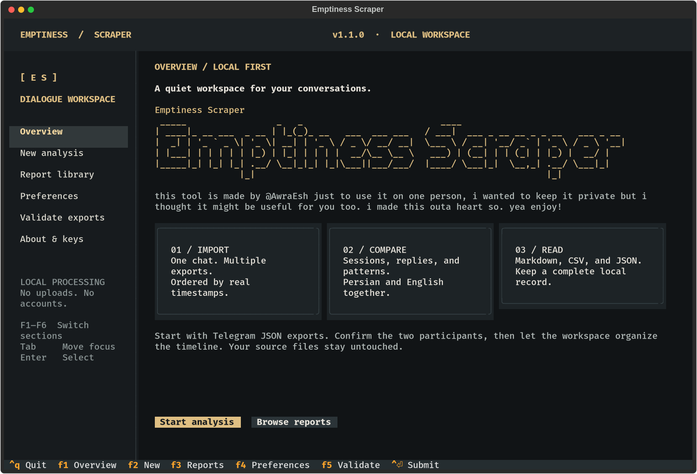

# Emptiness Scraper :0

Emptiness Scraper is an offline terminal application for comparing the observable activity of two participants in Telegram one-to-one JSON exports. It measures timing, participation, sessions, responses, gaps, bilingual text, emoji, and transparent rule-based events. It does not infer attraction, intent, personality, or psychological state.

Version 1.1.0 introduces a full-screen keyboard-driven workspace. Screens update in place, with a persistent sidebar, responsive forms, background analysis, and a paginated Markdown report library.



Telegram: @Ou_Rash

## Quick start

### Windows

1. Install Python 3.11 or newer from [python.org](https://www.python.org/downloads/). Enable “Add Python to PATH” during installation.
2. Double-click `run.bat`, or run it from Command Prompt.
3. Choose New analysis and paste JSON paths, one per line or separated with semicolons.

### Linux

```bash
python3 run.py
```

`python run.py` works on Windows too. Existing `run.sh` and `run.bat` wrappers remain available. The Python launcher creates a private `.venv`, checks dependencies, and opens the English full-screen interface. Source exports are read-only.

The first setup requires internet access. Later launches check installed package versions locally and work offline when requirements are satisfied. Dependency changes may require another online setup.

## Keyboard controls

### Persian display

In **Preferences (F4)**, choose **Persian terminal rendering**. Auto detects VTE/GNOME and uses native Unicode, leaving Persian shaping to the terminal. Unknown terminals show a reminder to check readability. Choose Native Unicode for GNOME Terminal; try Compatibility only on terminals without native Persian rendering. Save preferences and reopen the report preview. Fonts must include Persian glyphs; no mode can add missing font support. Report files and analysis data are never reshaped.

| Key | Action |
| --- | --- |
| Up / Down | Navigate menus and choices |
| Tab / Shift+Tab | Move between controls |
| Enter | Activate a choice or focused button |
| Space | Toggle a checkbox |
| Ctrl+Enter | Submit the current form, when supported by the terminal |
| F1 / F2 / F3 | Overview / New analysis / Reports |
| F4 / F5 / F6 | Preferences / Validation / About |
| Escape | Return to overview or close an open dialog |
| Ctrl+Q | Quit with confirmation |

All form actions also have buttons accessible with Tab and Enter. The app fills the current terminal window and redraws in place; it restores the previous terminal screen on exit. Below 96 columns, the sidebar is hidden and function-key navigation remains available. For the complete banner and side-by-side cards, use a terminal at least 124 columns wide. See [interface details](docs/TUI_1.1.0.md).

## Telegram export

In Telegram Desktop, export a private chat as machine-readable JSON. Media downloads are optional: timing and message-type statistics still work when media files are absent. Give the wizard either individual JSON files or a directory containing them. Filenames such as `1.json` and `2.json` are supported, but internal timestamps always decide the final order.

The identity screen shows every detected sender ID, display name, and message count. Assign accounts to Participant A, Participant B, or Exclude using the selection controls, then confirm the mapping. This supports conversations continued from changed accounts and allows bots or additional senders to be excluded.

## Reports

Every run creates a new timestamped directory containing:

- `report.md`
- Markdown appendices for sessions, responses, text, emoji, and rule events
- A full timeline appendix with monthly/quarterly comparisons, activity hours, input audit, and metric definitions
- CSV tables for every derived event
- `analysis.json`, a versioned machine-readable snapshot

The report may contain names and excerpts from the selected chat. Keep it private. For convenient reading, send the Markdown files to your Telegram Saved Messages.

The report library previews the main report and appendices inside the terminal in pages of 160 source lines. Markdown event times use the selected timezone with Gregorian and Jalali dates; machine-readable timestamps remain UTC. Monthly groups use Gregorian calendar months.

Version 1.0.1 includes a reliability review covering account aliases, chronology, period boundaries, missing reply targets, settings validation, and offline setup. See [the audit record](docs/AUDIT_2026-10-14.md) and [metric definitions](docs/METRICS.md) for exact behavior and limitations.

## Settings

The wizard manages timezone, session threshold, output directory, Persian and English stopwords, and editable signal patterns. The default timezone is `Asia/Tehran`. Other IANA names and fixed offsets such as `+04:00` are accepted.

The default session boundary is six hours. Four-hour and twelve-hour sensitivity counts are always included. Advanced analysis can mark intervals where the export is incomplete or another messenger was used; affected timing is retained in raw results and flagged out of comparison-safe metrics.

## Development

```bash
python3 -m venv .venv
.venv/bin/python -m pip install -r requirements-dev.txt
.venv/bin/python -m pytest
```

All tests use synthetic conversations. Do not add real exports or generated private reports to the repository.

## Troubleshooting

- If Python is not found, install Python 3.11+ and reopen the terminal.
- If package installation fails, check internet access and run the launcher again.
- If an export is rejected, verify that it is a one-to-one chat exported as JSON, not HTML, a group, or a channel.
- If Persian characters look incorrect, use a modern UTF-8 terminal such as Windows Terminal.
- If running from an IDE, choose its integrated terminal rather than a noninteractive output pane. Piped input is intentionally rejected for the full-screen UI.
- If Ctrl+Enter is not recognized, use Tab to focus the form's primary button and press Enter.
- `NO_COLOR` is respected for monochrome terminals. True-color terminals display the charcoal and amber theme.

